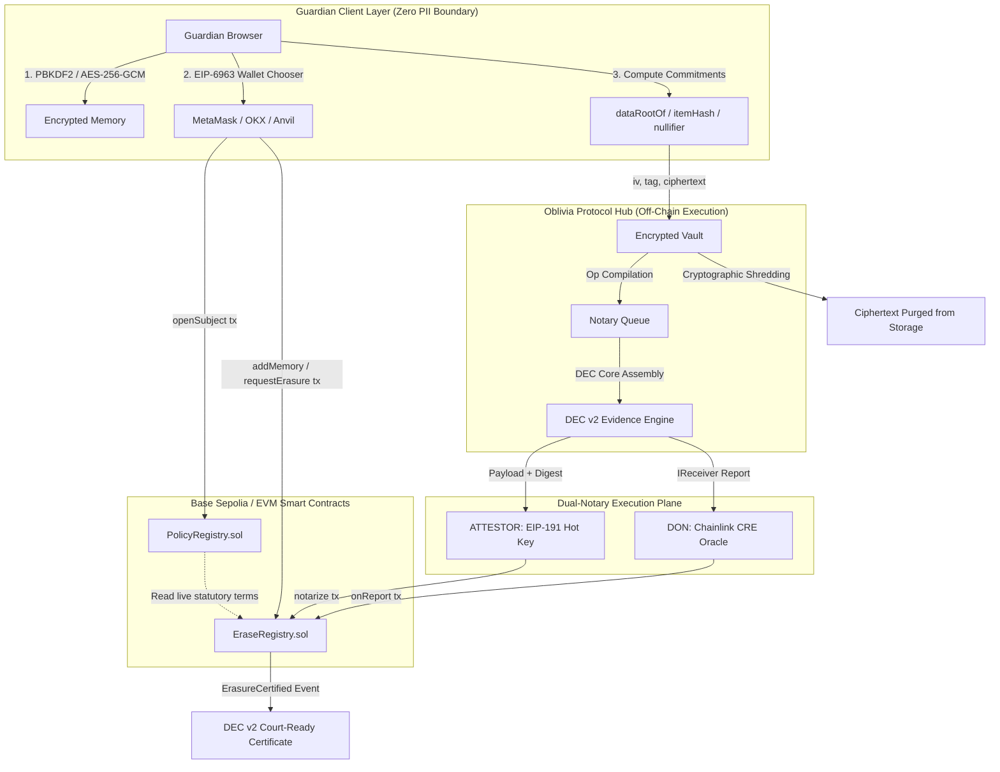

# OBLIVIA Protocol: Statute-Bound Verifiable Right-to-Erasure Protocol

> *"When organizations claim 'we deleted your child's data', verified by nobody and impossible to prove in court, OBLIVIA turns that unverified assertion into a notarized, statute-bound, on-chain evidence trail."*

[](https://dorahacks.io/hackathon/legal-hack-2026/detail)
[]()
[]()
[]()
[]()
[]()
[](LICENSE)

---

## 1. Executive Summary & Legal Framework

Digital platforms collect extensive telemetry, biometric signatures, educational metrics, and behavioral profiles from minors. International data protection statutes explicitly mandate that parents, guardians, and maturing minors hold an unalienable right to demand permanent data erasure:

- **GDPR Article 17 (EU)**: The "Right to be Forgotten", applying heightened protection to data collected from children.
- **COPPA Rule § 312.10 (US)**: Strict statutory caps on minor data retention and mandatory guardian-initiated deletion.
- **Maryland Online Data Privacy Act (MODPA)**: Enhanced prohibitions against minor behavioral profiling and automated commercial retention.
- **India DPDP Act § 9 (2023)**: Strict duties of data fiduciaries regarding children, including absolute tracking bans and verifiable erasure obligations.

### The Problem: The "Delete Email" Illusion
Under current enterprise compliance regimes, when a guardian exercises their statutory right to erasure, the platform responds with an unverified, centralized confirmation email stating: *"Your request has been processed."* 

This status quo suffers from critical structural failures:
1. **Zero Mathematical Proof**: The guardian cannot verify if their child's records were expunged or simply moved to cold storage or machine-learning training corpora.
2. **Zero Court Admissibility**: In regulatory enforcement proceedings or civil litigation, an email notification lacks non-repudiation, cryptographic timestamping, and independent witness attestation.
3. **The Blockchain Paradox**: Immutable public ledgers cannot store personally identifiable information (PII) directly without permanently violating the very privacy statutes they aim to enforce.

### The Solution: OBLIVIA Architecture
OBLIVIA bridges cryptographic immutability and statutory right-to-erasure through four core innovations:
1. **Zero-PII Cryptographic Isolation**: The on-chain registry records only mathematical commitments, nullifiers, and pseudonym hashes. Plaintext records remain encrypted on the client side via PBKDF2/AES-256-GCM.
2. **Policy Warden (`PolicyRegistry.sol`)**: Legal statutes are codified as versioned, queryable on-chain parameters rather than hard-coded heuristics.
3. **Sovereign Minor Rights Handover (`EraseRegistry.sol`)**: Guardian authority dynamically expires when the minor attains legal age under the governing jurisdiction; the young adult inherits exclusive sovereign authority to manage or erase their historical digital trail.
4. **DEC v2 (Digital Erasure Certificate)**: A deterministic cryptographic proof combining pre-receipt data nullifiers with on-chain dual-notary receipts (`ATTESTOR` and Chainlink CRE `DON`).

---

## 2. System Architecture & Cryptographic Isolation



---

## 3. Minor Rights Lifecycle & Authority Geometry

The lifecycle of minor data stewardship moves through five deterministic phases:

```mermaid
sequenceDiagram
    autonumber
    participant Guardian as Guardian Wallet
    participant Hub as Oblivia Hub Vault
    participant Policy as PolicyRegistry (On-Chain)
    participant Registry as EraseRegistry (On-Chain)
    participant Notary as Notary Engine (ATTESTOR / DON)

    Guardian->>Policy: Query active jurisdiction policy (e.g., CPP, EUR)
    Policy-->>Guardian: Active statute terms, retention caps, self-erase age
    Guardian->>Registry: Broadcast openSubject(subjectId, jurisdiction, vestEligibleAt)
    Registry-->>Guardian: Subject registered on-chain

    Guardian->>Hub: Encrypt item with browser key; store (iv, tag, cipher)
    Guardian->>Registry: Broadcast addMemory(subjectId, scopeRef, dataRoot)
    Registry-->>Guardian: Memory commitment pinned on-chain

    Note over Guardian,Registry: Statutory Age of Majority Reached (Vesting Phase)
    Guardian-xRegistry: Guardian authority expires automatically
    Note over Guardian,Registry: Adult Subject now holds exclusive sovereign authority

    Guardian->>Registry: Broadcast requestErasure(subjectId, scopeRef)
    Registry-->>Hub: ErasureRequested event emitted

    Hub->>Notary: Compile Op tuple, generate DEC v2 coreHash
    Notary->>Registry: Broadcast notarize(payload, signature)
    Registry->>Registry: Verify notary authority & guardian requestMade flag
    Registry-->>Hub: Emit ErasureCertified(subjectId, scopeRef, decHash)
    
    Hub->>Hub: Execute cryptographic shredding of ciphertext
    Hub-->>Guardian: Issue verifiable DEC v2 certificate
```

---

## 4. Evidence Engine: DEC v2 Specification

A Digital Erasure Certificate (DEC v2) is a tamper-evident, RFC 8785-canonicalized proof that links a real-world statutory obligation to an immutable on-chain confirmation.

### DEC v2 Data Structure

```
DEC v2 Evidence Container
├── schema: "oblivia.dec.v2"
├── subjectId: bytes32 (Pseudonymous commitment)
├── jurisdiction: string (ISO jurisdiction code: "CPP", "MDP", "EUR", "IND")
├── statuteCite: string (Statutory reference, e.g., "15 U.S.C. 6501 COPPA Rule § 312.10")
├── policyVersion: uint16 (Version index from PolicyRegistry)
├── scopeRef: bytes32 (Specific scope or 0x00...00 for FULL erasure)
├── actor: address (Guardian or self-erasing adult principal)
├── actorAuthority: string ("GUARDIAN" or "PRINCIPAL")
├── itemNullifiers: bytes32[] (Deterministic hashes of erased memories)
├── chainId: uint256 (EIP-155 chain ID, e.g., 84532)
├── opId: bytes32 (Deterministic operation hash)
├── coreHash: bytes32 (Pinned on-chain as Op.hashA)
└── receipt: ExecutionReceipt (Appended post-confirmation)
    ├── erasureTxHash: bytes32 (EVM transaction receipt hash)
    ├── blockNumber: uint256 (Mined block height)
    ├── notary: string ("ATTESTOR" or "DON")
    ├── confirmedAt: uint256 (ISO timestamp)
    └── fullHash: bytes32 (Root digest of complete certificate)
```

### Deterministic Nullifier Computation
Every data item is mapped to an independent nullifier without exposing plaintext:
1. `itemHash = keccak256(iv || tag || ciphertext)`
2. `nullifier = keccak256(itemHash || scopeRef || subjectId)`
3. When the erasure transaction is notarized, the ciphertext is purged from the hub vault, while the nullifiers remain mathematically verifiable by any auditor via `/verify`.

---

## 5. Released Developer SDK: `@oblivia/sdk`

The protocol primitives are packaged and published as an enterprise JavaScript/TypeScript SDK located in [`sdk/`](sdk/).

[](sdk/)
[](sdk/)

### Module Breakdown

| Module | Core Exports | Description |
| :--- | :--- | :--- |
| **`Oblivia.abi`** | `encodeOp`, `decodeOp`, `opIdOf`, `digestOf`, `signPayload`, `recoverPayloadSigner`, `bytes3` | Byte-for-byte ABI encoding matching `EraseRegistry.sol` tuple memory layouts with EIP-191 signer recovery. |
| **`Oblivia.dec`** | `buildDecCore`, `buildDecFull`, `verifyDec`, `stableStringify`, `decHashOf` | Deterministic RFC 8785 canonical JSON serializer, Merkle nullifier trees, and DEC v2 verification engine. |
| **`Oblivia.commitments`** | `itemHash`, `nullifierFor`, `dataRootOf`, `nullifiersFiltered` | Client-side cryptographic commitments and permutation-invariant Merkle roots. |
| **`Oblivia.txs`** | `TxFactory.openSubject`, `TxFactory.addMemory`, `TxFactory.requestErasure`, `TxFactory.notarize` | Unsigned transaction calldata generators compatible with MetaMask, Safe Multisig, and ERC-4337 bundlers. |
| **`Oblivia.chain`** | `registryContract`, `policyContract`, `decodeErasureCertified`, `decodeSubjectOpened` | Ethers v6 live read client and event log decoders. |

### SDK Integration Example

```javascript
import { Oblivia, bytes3, ZERO_SCOPE } from '@oblivia/sdk';
import { id } from 'ethers';

// Step 1: Derive zero-PII data commitments from client-encrypted items
const items = [
  { memoryId: 'memory-1', iv: '0x12..', tag: '0x34..', cipher: '0x56..' }
];
const dataRoot = Oblivia.commitments.dataRootOf(items);

// Step 2: Build unsigned transaction for subject enrollment
const openTx = Oblivia.txs.openSubject({
  subjectId: id('pseudonymous-minor-id'),
  jurisdiction: 'CPP', // COPPA Rule
  ageAttestationHash: id('legal-guardian-attestation'),
  dataRootCommitment: dataRoot,
  vestEligibleAt: 1780000000,
  nextBand: 1,
});

// Step 3: Compile pre-receipt DEC v2 evidence core
const { dec, coreHash } = Oblivia.dec.buildDecCore({
  subjectId: id('pseudonymous-minor-id'),
  jurisdiction: 'CPP',
  statuteCite: '15 U.S.C. 6501 COPPA Rule § 312.10',
  policyVersion: 1,
  scopeRef: ZERO_SCOPE, // Full subject wipe
  actor: '0xGuardianWalletAddress...',
  actorAuthority: 'GUARDIAN',
  itemNullifiers: items.map(Oblivia.commitments.nullifierFor),
  chainId: 84532, // Base Sepolia
  opId: id('op-erasure-request-1'),
});

// Step 4: Verify certificate validity independently
const verification = Oblivia.dec.verifyDec(dec, { coreHash });
console.log('Evidence Valid:', verification.ok); // true
```

---

## 6. Smart Contracts & Security Architecture

The smart contracts are written in Foundry-tested Solidity with strict security checks:

### `PolicyRegistry.sol`
- **Dynamic Statute Registration**: Authorized curators update jurisdiction terms (`CPP`, `MDP`, `EUR`, `IND`) with statutory citations, self-erasure threshold ages, and profiling bans.
- **Historical Immutability**: Historical enrollments reference static policy versions; changing a legal threshold updates future subjects without rewriting historical legal ground-truth.

### `EraseRegistry.sol`
- **Strict Role-Based Authority Checks**:
  - `openSubject`: Requires a non-zero guardian and a valid jurisdiction policy.
  - `addMemory`: Enforces that only the registered guardian (prior to vesting) or the principal (after vesting) can record memory commitments.
  - `requestErasure`: Records an on-chain `requestMade` state flag. The protocol strictly reverts any notarization attempt that lacks a verified antecedent request from the authorized party.
- **Replay Protection**: Every operation is bound to a deterministic `opId = keccak256(abi.encode(chainId, registryAddress, op))`. Executed operations are permanently flagged in the `executedOp` mapping.
- **Dual-Notary Interface**:
  - **`notarize(bytes payload, bytes sig)`**: Verifies that the EIP-191 signature was produced by the designated protocol attestor key. Anyone may submit the transaction (permissionless witness execution), but only valid attestor signatures execute.
  - **`onReport(bytes metadata, bytes report)`**: Implements Chainlink's `IReceiver` interface to ingest consensus-driven reports from the Chainlink CRE Decentralized Oracle Network.

---

## 7. Web Application & FirmDepth Interface Suite

The protocol frontend is an institutional Multi-Page Application (MPA) running on Express and vanilla ES modules, styled with the **FirmDepth Design System** (`--canvas: #f2f0e9`, `--paper: #fbfaf6`, `--deep: #1c241e`, `--blue: #2456e6`, `--lime: #c9f36b`).

```
hub/views/
├── index.html       Institutional Overview, live RPC status, statutory thesis
├── guardian.html    Guardian Sovereign Console: live policy chips, PBKDF2 encryption, step tracker
├── explorer.html    Real-time ledger explorer reading on-chain op logs and certificates
├── verify.html      Zero-backend independent DEC v2 verification engine
├── cert.html        Court-ready Digital Erasure Certificate view with printable audit trail
├── passport.html    Minor cryptographic identity passport with countdown to legal vesting
├── kid.html         Client-side encrypted memory custody and item inspection
├── seal.html        Dual-notary queue with manual on-chain execution triggers
└── docs.html        Statutory concordance, threat models, and architectural specifications
```

### Slide-Down Multi-Wallet Chooser
The universal header features a non-intrusive slide-down wallet modal (`.wallet-dialog`):
- **MetaMask**: EIP-6963 provider isolation (`io.metamask`), ensuring other installed browser extensions cannot override the user's intent.
- **OKX Wallet**: Native multi-chain Web3 extension discovery (`com.okx.wallet`).
- **Browser Injected**: Generic fallback for standard EVM browser providers.
- **Local Anvil Dev Signer**: Instant 1-click connection to account `0xf39Fd6e51aad88F6F4ce6aB8827279cffFb92266` (preloaded with 10,000 ETH) for frictionless testing and grading without browser extension dialogs.

---

## 8. Test Coverage & Verification

Every component is accompanied by comprehensive automated verification:

### 1. Smart Contract Test Suite (Foundry)
```bash
~/.config/.foundry/bin/forge test --root contracts
```
Output:
```
Ran 13 tests for test/EraseRegistry.t.sol:EraseRegistryTest
[PASS] test_addMemory_ghostedAfterScopeErase() (gas: 487601)
[PASS] test_addMemory_rejectedForStranger() (gas: 216051)
[PASS] test_erase_requires_guardian_request() (gas: 225022)
[PASS] test_fullScope_erase_forgottenForever() (gas: 521247)
[PASS] test_notarize_replay_reverts() (gas: 447885)
[PASS] test_notarize_wrongSigner_reverts() (gas: 274717)
[PASS] test_onReport_forwarder_only() (gas: 479079)
[PASS] test_openSubject_binds_live_policy() (gas: 197758)
[PASS] test_openSubject_horizon_reverts() (gas: 41875)
[PASS] test_openSubject_twice_reverts() (gas: 206257)
[PASS] test_openSubject_unknownJurisdiction_reverts() (gas: 48905)
[PASS] test_policyActive() (gas: 30488)
[PASS] test_vest_after_threshold_only() (gas: 444649)
Suite result: ok. 13 passed; 0 failed; 0 skipped; 13 total tests
```

### 2. SDK Test Suite (Node.js Test Runner)
```bash
cd sdk && npm test
```
Output:
```
ℹ tests 663
ℹ suites 0
ℹ pass 663
ℹ fail 0
ℹ cancelled 0
ℹ skipped 0
ℹ duration_ms 807ms
```

### 3. End-to-End Headless Validation
```bash
node hub/scripts/e2e.mjs
```
Validates the full lifecycle headlessly against live transactions: enrollment, memory addition, erasure request, attestor signing, on-chain confirmation, and DEC v2 verification.

---

## 9. Quickstart Guide (Local Environment)

### Prerequisites
- Node.js v20+
- Foundry (`forge`, `anvil`)

### Step-by-Step Execution

```bash
# 1. Clone repository
git clone https://github.com/ROHANROOSWELT/OBLIVIA.git
cd OBLIVIA

# 2. Run local Anvil chain, deploy contracts, and seed policies
bash scripts/run-local.sh

# 3. Start the Oblivia Web Hub
node hub/src/server.js
# Access application at http://127.0.0.1:3000

# 4. In a secondary terminal, start the automated attestor notary daemon
node hub/run-attestor.js
```

---

## 10. Testnet Deployment (Base Sepolia)

To deploy the smart contracts to Base Sepolia:

```bash
# Set configuration
export RPC_URL="https://sepolia.base.org"
export PRIVATE_KEY="<YOUR_DEPLOYER_PRIVATE_KEY>"
export ETHERSCAN_API_KEY="<YOUR_ETHERSCAN_V2_KEY>"

# Run deployment script
bash scripts/deploy.sh
```

Contract addresses and deployment metadata are written to [`contracts/deployments.json`](contracts/deployments.json) and exported to the hub.

---

## 11. Protocol Limitations & Honest Boundaries

In the spirit of rigorous engineering and transparent evaluation, OBLIVIA documents its exact boundaries:

1. **Age Assurance Boundary**: The protocol verifies guardian authority and timestamp vesting against on-chain policy tables. Zero-knowledge age proofs or identity verification (e.g., zk-KYC, CLEAR) are designed to feed into `openSubject` as an external input hash (`ageAttestationHash`), but the identity oracle itself is decoupled from the protocol core.
2. **Hub Demo Storage**: The hub currently stores client-encrypted blobs in local storage for demonstration simplicity. In production enterprise deployments, the hub vault swaps to an append-only verifiable manifest log.
3. **Notary Permissionless Sealing**: Anyone can pay gas to submit a validly signed `notarize()` transaction. This is a deliberate resilience feature: even if the protocol hub goes offline, any witness or guardian can submit the signed payload to finalize the erasure on-chain.

---

## 12. GitHub Repository "About" Metadata

For the GitHub repository settings, use the following configuration:

### Description
> Statute-bound verifiable right-to-erasure protocol for minors in immutable digital systems. Zero PII on-chain, DEC v2 evidence engine, Base Sepolia, and dual-notary execution. Built for BLI Legal Tech Hackathon 2.

### Website
> `http://127.0.0.1:3000` (or your live deployment URL)

### Topics / Tags
```
legaltech regtech gdpr-article-17 coppa-compliance dpdp-act right-to-erasure minor-privacy zero-pii digital-erasure-certificate chainlink-cre base-sepolia smart-contracts foundry web3-security
```

---

## 13. License

This repository is distributed under the **MIT License**. See [`LICENSE`](LICENSE) for details.
